  <!-- Banner Customizado -->
  

    

  

    
    &nbsp;
    
    &nbsp;
    
    &nbsp;
    
  

---

### 👨‍💻 Sobre Mim

Sou **Técnico em Informática** e formando em **Sistemas de Informação (FAESA)**, localizado em **São Mateus, ES**. Atuo no desenvolvimento de aplicações **Web** e **Mobile**, unindo engenharia de software moderna a uma base sólida em **Infraestrutura, Redes, Automação e Suporte de TI** construída em experiências no **IFES**, **Polo UAB**, **Prefeitura Municipal de São Mateus** e **Plena Benefícios**.

- 🎓 Formando em **Bacharelado em Sistemas de Informação** (FAESA) & **Técnico em Informática**
- 💻 Foco principal no ecossistema **TypeScript**, **React**, **Next.js**, **React Native (Expo)**, **Tailwind CSS**, **TanStack Query** e **Zustand**
- ⚙️ Experiência com back-end, automação e bancos de dados utilizando **Node.js**, **Express**, **MongoDB**, **SQLite**, **TypeORM**, **Python**, **PowerShell**, **Java**, **C/C++** e **Go**
- 🖥️ Vivência prática em **Infraestrutura de TI**, administração de **Active Directory (AD)**, redes de computadores, monitoramento remoto e suporte técnico
- 🌐 Explore meu portfólio completo, currículo e projetos: [**rafaelmm16.github.io**](https://rafaelmm16.github.io/)

---

### 🛠️ Tecnologias & Ferramentas

| Categoria | Tecnologias |
| :--- | :--- |
| **Front-end & Mobile** |  |
| **Back-end & Linguagens** |  |
| **Infra & Ferramentas** |  |

---

### 🚀 Projetos em Destaque

<!-- PROJECTS:START -->
| Projeto | Descrição | Tecnologias | Links |
| :--- | :--- | :--- | :---: |
| **🌐 Portfólio Pessoal** | Portfólio interativo apresentando minha trajetória profissional, formação, certificações e vitrine integrada ao GitHub. | `Next.js` `TypeScript` `Tailwind CSS` | [Deploy](https://rafaelmm16.github.io/) &bull; [Código](https://github.com/rafaelmm16/rafaelmm16.github.io) |
| **💻 Clicker Project** | Jogo clicker em duas versões no mesmo repositório: versão web com estética Retro Terminal/Cyberpunk (upgrades, prestígio e conquistas) e versão original de terminal em C. | `Next.js` `TypeScript` `Tailwind CSS` `C` | [Deploy](https://rafaelmm16.github.io/Clicker-Project/) &bull; [Código](https://github.com/rafaelmm16/Clicker-Project) |
| **📦 Monitor de Rede e Servicos Self Hosted** | Projeto desenvolvido e disponível no GitHub. | `TypeScript` | [Código](https://github.com/rafaelmm16/Monitor-de-Rede-e-Servicos-Self-Hosted) |
| **📦 Go Lang** | Repositório de estudo sobre a linguagem Go Lang | `Go` `golang` | [Código](https://github.com/rafaelmm16/Go-Lang) |
| **🎓 College** | Monorepositório e vitrine interativa reunindo os códigos e projetos de 19 disciplinas da graduação em Sistemas de Informação (como SGBus, Recicla Capixaba e Delivery Web App). | `Next.js` `TypeScript` `Tailwind CSS` | [Deploy](https://rafaelmm16.github.io/College/) &bull; [Código](https://github.com/rafaelmm16/College) |
| **🚀 Rocketseat Hub** | Monorepositório e portal unificado reunindo 8 projetos de cursos e eventos da Rocketseat (pass.in, Cook App, My Goals, nivo.video, Orders, To-Do List API, Proffy e Ecoleta). | `Next.js` `TypeScript` `React Native` `Node.js` `Java` | [Deploy](https://rafaelmm16.github.io/Rocketseat/) &bull; [Código](https://github.com/rafaelmm16/Rocketseat) |
| **🎨 Web Development** | Diretório interativo com 22 projetos front-end: clones de interfaces (Netflix, YouTube, Pinterest, Apple), landing pages, telas de login, componentes UI e laboratórios JS. | `HTML5` `CSS3` `JavaScript` `Tailwind CSS` `Bootstrap` | [Deploy](https://rafaelmm16.github.io/Web-Development/) &bull; [Código](https://github.com/rafaelmm16/Web-Development) |
<!-- PROJECTS:END -->
<!-- PROJECTS:END -->

---

### 📊 Métricas & Estatísticas no GitHub

  

  

---

### 📬 Vamos Conversar?

Seja para trocar ideias sobre desenvolvimento, discutir novos projetos ou oportunidades:

   
  
  &nbsp;&nbsp;
  
  &nbsp;&nbsp;
  
    

